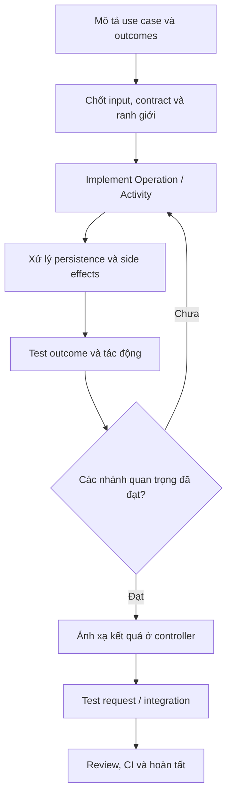

# Quy trình triển khai một use case với Trailblazer trên Rails 8

> Trạng thái: quy trình chuẩn nội bộ
> Phạm vi: thiết kế, triển khai, kiểm thử và review một use case trong ứng dụng Rails dùng Trailblazer.

Tài liệu này là hướng dẫn thực hiện theo từng bước. Quy ước kiến trúc, namespace số nhiều (`operations/`, `contracts/`, `activities/`) và ví dụ Operation gọi Activity nằm trong [Chuẩn phát triển Trailblazer trên Rails 8](trailblazer-standard.md).

## Quy trình triển khai một use case

Quy trình dưới đây biến các bài học về Operation, Railway, kiểm thử và tái sử dụng trong cuốn *Building your own authentication library with Trailblazer* thành các bước áp dụng cho tính năng Rails. Các yêu cầu bảo mật hoặc nghiệp vụ cụ thể trong sách không tự động trở thành quy định công ty.

### Bước 1: Mô tả use case và kết quả

Trước khi viết code, mô tả ngắn gọn:

- Ai khởi tạo use case và mục tiêu của họ là gì.
- Input nào được phép nhận; actor/phụ thuộc nào cần truyền vào.
- Dữ liệu hoặc side effect nào được tạo/cập nhật.
- Kết quả cần phân biệt: thành công, input không hợp lệ, không tìm thấy, không được phép, xung đột hoặc lỗi hệ thống.
- HTTP response nào tương ứng với từng kết quả nếu use case được gọi từ web/API.

Mỗi Operation đại diện cho một hành động nghiệp vụ có tên rõ ràng, như `Register`, `Publish` hoặc `ResetPassword`. Không thiết kế theo số lượng controller action; background job, tác vụ quản trị hoặc script cũng có thể gọi cùng use case.

### Bước 2: Chọn ranh giới lớp và interface

- Controller giữ trách nhiệm HTTP: lọc params theo Rails, truyền actor/input, gọi Operation, ánh xạ outcome thành render/redirect/status.
- Operation điều phối thứ tự bước và outcome. Nó không nhận dependency ngầm từ request, session hoặc controller.
- Contract định nghĩa payload và validation của một use case.
- Model giữ persistence và invariant thuộc domain; service/job/mailer thực hiện phần việc chuyên biệt được gọi từ Operation.
- Chỉ tách Activity/Operation con khi có quy trình dùng lại hoặc luồng nhiều nhánh cần đặt tên, test và theo dõi độc lập.

Trước khi implement, ghi rõ interface của Operation: keyword đầu vào, dữ liệu ổn định mà caller cần đọc từ result, và các terminus/outcome. `ctx` là interface giữa các bước; chỉ đưa ra ngoài các biến caller thật sự cần. Đổi tên hoặc bỏ một output đang được caller dùng là thay đổi interface.

### Bước 3: Implement từ tuyến thành công rồi thêm nhánh lỗi

1. Khai báo từng bước theo thứ tự nghiệp vụ: tìm đối tượng, kiểm tra quyền, xác thực input, ghi dữ liệu, rồi side effect.
2. Mỗi bước làm một việc và dùng keyword arguments để khai báo rõ dependency/input cần thiết.
3. Ghi kết quả cho bước sau vào `ctx` bằng key có nghĩa; trả success/failure theo cơ chế DSL đang dùng.
4. Với mỗi failure, xác định điểm dừng và thông tin caller được phép nhận. Nếu nhiều failure handler nằm trên cùng failure track, bảo đảm lỗi trước không bị handler sau ghi đè; dùng wiring phù hợp với phiên bản gem.
5. Với Operation con/Activity, dùng `Subprocess(...)` để composition mặc định tự truyền context và nối các outcome tương ứng. Nếu có terminus hoặc dữ liệu vào/ra tùy chỉnh, khai báo mapping/wiring rõ ràng và test interface đó.

Không bắt exception để biểu diễn validation failure thông thường. Chỉ rescue exception dự kiến tại ranh giới có thể xác định (ví dụ xung đột unique constraint), chuyển nó thành outcome có nghĩa; để exception bất ngờ tiếp tục nổi lên để hệ thống báo lỗi và ghi nhận.

### Bước 4: Xử lý persistence và side effect

- Dùng validation để đưa thông báo phù hợp cho input; dùng ràng buộc DB làm hàng rào cuối cho uniqueness và invariant dữ liệu.
- Cân nhắc race condition: validation trước khi lưu không thay thế unique index/constraint trong database.
- Xác định transaction boundary cho các lần ghi phải thành công/thất bại cùng nhau.
- Gửi email, enqueue job hoặc gọi dịch vụ ngoài theo chính sách của dự án; quy định rõ retry, tính idempotent và cách xử lý nếu side effect thất bại sau khi dữ liệu đã commit.
- Không đưa orchestration nghiệp vụ vào callback model chỉ để tránh thêm một bước tường minh.

### Bước 5: Viết test theo outcome và tác động

Viết test cho Operation trực tiếp bằng input cụ thể. Bao phủ ít nhất:

- Tuyến thành công: result/outcome đúng và thay đổi dữ liệu dự kiến đã xảy ra.
- Từng failure quan trọng: dữ liệu không bị ghi dở, error/outcome phù hợp và không chạy bước sau không cần thiết.
- Tình huống biên có ý nghĩa: bản ghi không tồn tại, input sai, quyền bị từ chối, unique conflict, token hết hạn hoặc gọi lặp nếu use case có các trường hợp đó.
- Side effect: job/email được enqueue hoặc nội dung/output được tạo theo yêu cầu, không chỉ kiểm tra rằng method nội bộ đã được gọi.
- Request/integration: controller trả đúng status, redirect/render và truyền input đã lọc.

Test outcome công khai và hiệu ứng quan sát được; tránh phụ thuộc vào thứ tự gọi của step riêng tư hoặc mọi biến tạm trong `ctx`. Dùng `wtf?`/trace để tìm đường chạy và bước phát sinh lỗi khi debug, không dùng output trace làm assertion của test.

### Bước 6: Refactor khi có bằng chứng về phần dùng chung

Cuốn sách cho thấy việc copy phần tạo/lưu key giữa hai use case nhanh chóng tạo trùng lặp; sau đó trích phần dùng chung thành component con và gọi bằng `Subprocess`. Quy tắc công ty: trước khi trích, kiểm tra hai luồng thực sự có cùng trách nhiệm và cùng semantics; nếu chỉ giống vài dòng nhưng khác chính sách, giữ riêng hoặc trích hàm thuần nhỏ. Sau khi tách, test component con độc lập và test ít nhất một caller tích hợp với nó.

Mapping `input`/`output` giúp khai báo interface của component con. Chỉ dùng khi cần giới hạn/đổi tên dữ liệu hoặc cấu hình; không dùng mapping để che giấu một contract không rõ ràng. Mọi outcome ngoài `success`/`failure` phải được nối rõ ở caller.

### Bước 7: Hoàn tất và review

Một use case sẵn sàng review khi:

- [ ] Operation/Contract/Activity nằm đúng concept và dùng namespace số nhiều theo chuẩn công ty.
- [ ] Controller chỉ nối HTTP với Operation; không có business branching lặp lại ở controller/view.
- [ ] Input, output, quyền truy cập, failure và side effect được nêu rõ.
- [ ] Tests bao phủ thành công, failure quan trọng, tác động dữ liệu và response HTTP liên quan.
- [ ] Cú pháp gem và test command đã đối chiếu với repository thực tế (`Gemfile.lock`, cấu hình test và CI).
- [ ] Không còn code trùng lặp vừa được tạo; component dùng chung có interface và test.
- [ ] Log/trace không làm lộ password, token, thông tin nhạy cảm hoặc payload riêng tư.

Chạy test mục tiêu rồi bộ test/CI mà dự án yêu cầu. Không xem trace xanh hoặc một unit test là bằng chứng thay thế cho kiểm thử tích hợp, security review hoặc kiểm tra side effect cần thiết.

## Nguồn và giới hạn áp dụng

Quy trình chuyển hóa các bài học về Operation, Railway, kiểm thử và tái sử dụng trong *Building your own authentication library with Trailblazer* (Nick Sutterer, ấn bản 2021) thành hướng dẫn phát triển tính năng Rails. Các yêu cầu bảo mật hoặc nghiệp vụ cụ thể trong sách không tự động trở thành quy định công ty. Sách chủ yếu trình bày Operation và unit test; không bỏ qua request/integration test, review hoặc CI khi áp dụng quy trình này.

Trailblazer tham khảo thuộc nhánh 2.1. Xác minh DSL, wiring, `Subprocess` và lệnh test theo phiên bản gem khóa trong `Gemfile.lock` của dự án trước khi áp dụng.
